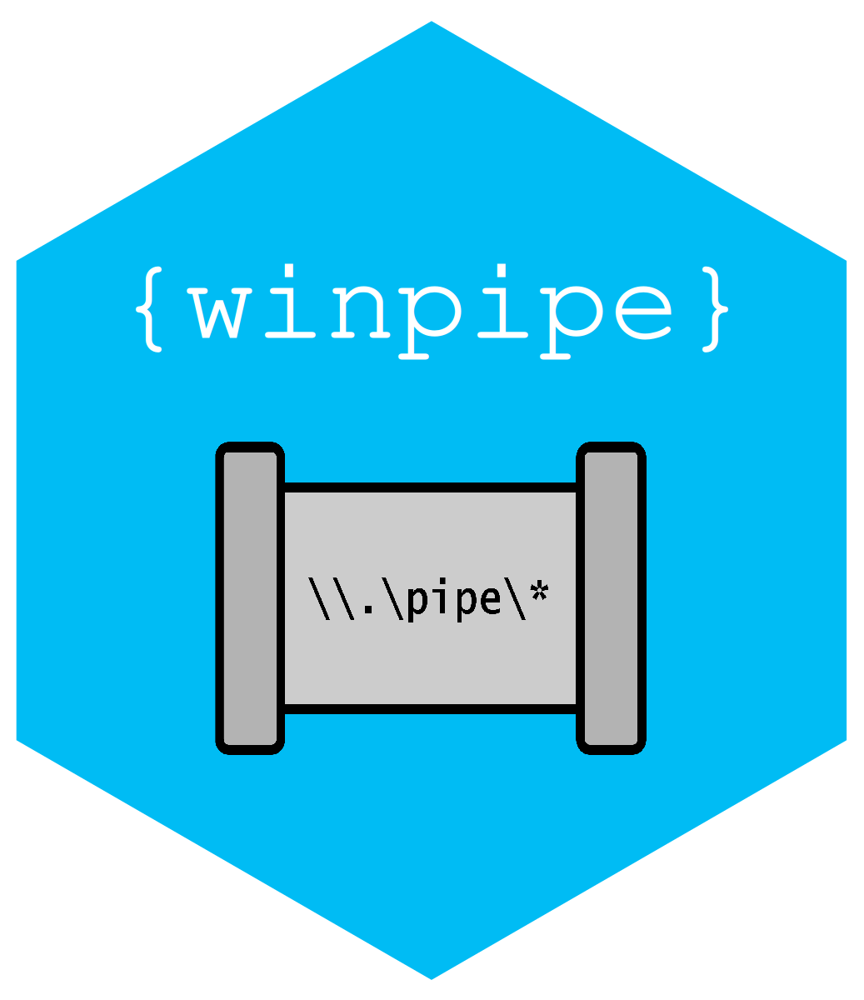

<!-- README.md is generated from README.Rmd. Please edit that file -->

# winpipe 

<!-- badges: start -->

[](https://github.com/jslth/winpipe/actions/workflows/R-CMD-check.yaml)
[](https://CRAN.R-project.org/package=winpipe)
[](https://www.repostatus.org/#active)
<!-- badges: end -->

`{winpipe}` exposes Win32 Named Pipes as R connections to read from and
write to. Named Pipes are a device for inter-process communication (IPC)
that are part of the file system and allow for fine-grained access
control. R has native support for FIFOs on Unix-like systems but does
not expose any API for named pipes on Windows.

Features:

- Create and serve Windows named pipes, i.e., R can be both client and
  server
- Named pipes are represented as native R connections, i.e., I/O works
  out of the box
- Let R talk to non-R processes
- Can accept clients without blocking the R session
- Includes an interface to
  [SDDL](https://learn.microsoft.com/en-us/windows/win32/secauthz/security-descriptor-definition-language)

## Installation

You can install the development version of winpipe from
[GitHub](https://github.com/) with:

``` r
# install.packages("pak")
pak::pak("jslth/winpipe")
```

## Example

To communicate between processes, a server and a client are required:

``` r
library(winpipe)

server <- winpipe("a-pipe")
client <- winpipe("a-pipe", server = FALSE)
```

Since winpipes are R connections, most I/O functions work out of the
box. You can, for example, pass the client as a file name to
`write.csv()`:

``` r
write.csv(iris, file = client)
```

The server can then receive the data. Depending on the permissions, this
works in both directions (client → server and server → client)

``` r
head(read.csv(server))
#>   X Sepal.Length Sepal.Width Petal.Length Petal.Width Species
#> 1 1          5.1         3.5          1.4         0.2  setosa
#> 2 2          4.9         3.0          1.4         0.2  setosa
#> 3 3          4.7         3.2          1.3         0.2  setosa
#> 4 4          4.6         3.1          1.5         0.2  setosa
#> 5 5          5.0         3.6          1.4         0.2  setosa
#> 6 6          5.4         3.9          1.7         0.4  setosa
```

Beware, however, that reading consumes a payload. Another call to
`read.csv()` would result in an error. You can peek a payload without
consuming it using `np_peek()`. This confirms that the payload has been
consumed by giving the number of bytes left to read.

``` r
np_peek(server)
#> [1] 0
```

One cool thing about named pipes is their access control. Named pipes
support security descriptors using
[DACL](https://de.wikipedia.org/wiki/Discretionary_Access_Control) and
`{winpipe}` includes a small API to construct ACLs. To allow only admins
and the local system to access a named pipe, you can do:

``` r
sd <- sd_create(
  ace(type = "deny", rights = "generic all", account = "everyone"),
  ace(type = "allow", rights = "generic all", account = "admins"),
  ace(type = "allow", rights = "generic all", account = "local system")
)
sd
#> <winpipe_sd>
#> D:(D;;GA;;;WD)(A;;GA;;;BA)(A;;GA;;;SY)
```

A winpipe created with this security descriptor will deny access to all
non-privileged users. You can pass this security descriptor to a pipe
you create and it will adhere to this access control. `np_sd()` allows
you to read the security descriptor of a given named pipe (note that
Windows “normalizes” the descriptor, so it might not look like your
input).

``` r
pipe <- winpipe("sd-pipe", sddl = sd)
np_sd(pipe)
#> <winpipe_sd>
#> O:S-1-5-21-1492369709-893483088-3947136618-1001G:S-1-5-21-1492369709-893483088-3947136618-1001D:(D;;FA;;;WD)(A;;FA;;;BA)(A;;FA;;;SY)
```

## Related work

- [`processx`](https://processx.r-lib.org/) can emulate named pipes as
  child processes
- [`httppipe`](https://github.com/richfitz/httppipe) uses `reticulate`
  to communicate with named pipes through Python
